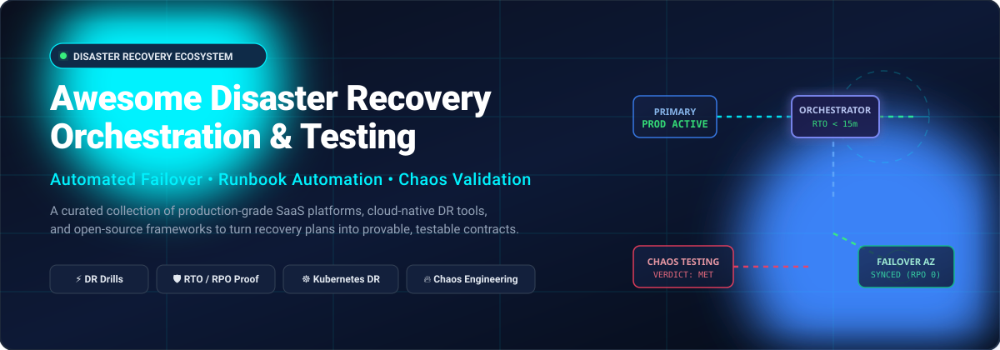

# 🛡️ Awesome Disaster Recovery Orchestration & Testing

<p align="center">
  
</p>

<p align="center">
  <a href="https://github.com/ishandutta2007/Awesome-Awesome-Awesome"></a>
  <a href="https://discord.gg/jc4xtF58Ve"></a>
  <a href="https://github.com/ishandutta2007/Awesome-Disaster-Recovery-Orchestration-Testing/stargazers"></a>
  <a href="https://github.com/ishandutta2007/Awesome-Disaster-Recovery-Orchestration-Testing/network/members"></a>
  <a href="https://github.com/ishandutta2007/Awesome-Disaster-Recovery-Orchestration-Testing/blob/main/LICENSE"></a>
  <a href="https://github.com/ishandutta2007"></a>
</p>

---

## 📑 Top Disaster Recovery Orchestration & Testing Ecosystem

**A Curated Directory of SaaS Platforms & Open-Source GitHub Projects for Disaster Recovery (DR), Business Continuity (BC), Automated Failover, Chaos Engineering & Recovery Validation.**

> **Last updated: March 2026**

This repository is an SEO-optimized knowledge hub tracking production-grade **SaaS platforms** and **open-source DR tools** engineered for modern site reliability engineering (SRE) and DevOps workflows. Rather than treating disaster recovery as an unverified checklist, these solutions help teams orchestrate recovery runbooks, automate cross-region / multi-cluster failover, execute non-disruptive DR drills, and **prove RTO (Recovery Time Objective) and RPO (Recovery Point Objective)** through continuous validation.

---

## 🧭 Table of Contents
- [📊 Sector Overview & Market Dynamics](#-sector-overview--market-dynamics)
- [☁️ SaaS & Hosted Enterprise Platforms](#️-saas--hosted-enterprise-platforms)
- [🔓 Open-Source GitHub Projects](#-open-source-github-projects)
- [🛠️ Architecture Patterns for Custom DR Stacks](#️-architecture-patterns-for-custom-dr-stacks)
- [🤝 How to Contribute](#-how-to-contribute)
- [⭐ Star History](#star-history)
- [💖 Support & Sponsorship](#-support--sponsorship)
- [⚠️ Disclaimer](#️-disclaimer)

---

## 📊 Sector Overview & Market Dynamics

The global Disaster Recovery as a Service (DRaaS) and orchestration market is estimated at **$16B–$17.5B in 2026** and projected to grow beyond **$50B–$70B by the 2030s** at a 20–25% CAGR. 

The sector exhibits a **dual market structure**:
* **Infrastructure Tier (Moderately Concentrated):** Anchored by hyperscalers (Microsoft Azure, AWS) and consolidated enterprise cyber-resilience giants (Veeam, HPE, Cohesity, Commvault) providing comprehensive multi-cloud data protection suites.
* **Specialized & Orchestration Tier (Highly Fragmented):** Supported by a vibrant ecosystem of cloud-native Kubernetes backup operators, active chaos engineering platforms, and regional Managed Service Providers (MSPs) catering to strict data sovereignty and local compliance mandates.

---

## ☁️ SaaS & Hosted Enterprise Platforms

Enterprise-grade SaaS and managed cloud solutions for automated failover, cloud disaster recovery, and continuous data protection. Sorted by company scale (valuation / market capitalization descending).

| Product 🏢 | Company Scale (Valuation / Revenue) 📈 | Starting Tier Pricing 💳 | Free Tier / Trial Limits ⏳ | Core Capabilities & Recovery Scope ⚙️ |
|:---|:---|:---|:---|:---|
| **[Azure Site Recovery](https://azure.microsoft.com/en-us/products/site-recovery)** | ~$3.89T market cap (Microsoft) | $25.00 / protected instance / month (+ storage & egress) | First 31 days free per protected instance; Azure free account includes $200 credits for 30 days | Recovery plans with ordered VM groups, cross-region replication, and Azure Automation runbook integration. Pay-as-you-go per protected instance. |
| **[AWS Elastic Disaster Recovery](https://aws.amazon.com/disaster-recovery/)** | ~$2.88T market cap (Amazon) | $0.028 / source server / hour (~$20.44 / server / month) | No standalone free days; covered under AWS Free Account onboarding credits ($100–$200 credit across AWS services) | Continuous block-level replication with point-in-time recovery, automated drill execution, and fast failback for EC2 and on-premise workloads. |
| **[Zerto](https://www.zerto.com/)** | ~$64B market cap (Parent: HPE; acquired for $374M) | ~$1,000 / protected VM / year | 14-day free trial supporting up to 15 virtual machines | Continuous data protection (CDP) with journal-based recovery and multi-VM failover orchestration. Enables non-disruptive DR testing. |
| **[Veeam Disaster Recovery Orchestrator](https://www.veeam.com/)** | $15B valuation (~$1.7B ARR) | ~$1,800 / year (10-instance VUL pack in Data Platform Premium) | 30-day full-featured free trial of Veeam Data Platform (no credit card required) | One-click orchestration plans with automated testing, isolated test labs, audit-ready compliance documentation, and VMware/Azure recovery. |
| **[Cohesity SiteContinuity](https://www.cohesity.com/)** | ~$7B–$9B valuation (~$1.5B revenue) | ~$150–$400 / TB / year (capacity subscription) | 30-day trial for cloud services / DPaaS (enterprise DR drill trial coordinated via sales) | Converged backup and automated DR with policy-driven failover, instant mass restore, and unified cyber-recovery orchestration. |
| **[Commvault Disaster Recovery](https://www.commvault.com/)** | ~$6.4B market cap (~$900M ARR) | $58.50 / TB / month (Commvault Cloud SaaS) or ~$98 / VM / year | 30-day free trial with full feature access and zero upfront credit card commitment | Enterprise DR orchestration featuring cleanroom isolated testing, automated recovery verification, and immutable storage targets. |
| **[Druva](https://www.druva.com/)** | ~$2B valuation (~$200M+ ARR) | ~$200 / TB / month (or $8 / user / month for endpoint tiers) | 30-day free trial with full SaaS platform capability | 100% cloud-native SaaS backup and DR with automated recovery orchestration, ransomware quarantine, and pre-built recovery runbooks. |

---

## 🔓 Open-Source GitHub Projects

Self-hosted, transparent, and community-driven projects for Kubernetes disaster recovery, chaos-driven recovery drills, and contract-based DR validation. **Sorted strictly by GitHub Star Count (descending)**.

| Project 📦 | Star Count Badge 🌟 | Category / Focus 🎯 | Description & Architectural Highlights 🔍 |
|:---|:---|:---|:---|
| **[Restic](https://github.com/restic/restic)** | [](https://github.com/restic/restic/stargazers) | Secure Storage & Backup Engine | Fast, secure, and cross-platform backup program using client-side cryptography. Deduplicates data chunks across snapshots and serves as the rock-solid storage foundation for numerous Kubernetes DR operators (including Velero and K8up). |
| **[Velero](https://github.com/vmware-tanzu/velero)** | [](https://github.com/vmware-tanzu/velero/stargazers) | Kubernetes Backup & Migration | The de facto industry standard for Kubernetes disaster recovery, cluster migration, and persistent volume snapshotting. Backs up cluster resources and persistent volumes to Amazon S3, Google Cloud Storage, or Azure Blob. |
| **[Longhorn](https://github.com/longhorn/longhorn)** | [](https://github.com/longhorn/longhorn/stargazers) | Cloud-Native Distributed Storage & DR | Lightweight, distributed block storage system for Kubernetes with built-in cross-cluster Disaster Recovery volumes. Supports asynchronous replication to secondary clusters and automated snapshot/backup scheduling. |
| **[Chaos Mesh](https://github.com/chaos-mesh/chaos-mesh)** | [](https://github.com/chaos-mesh/chaos-mesh/stargazers) | Chaos Engineering & Resilience Testing | CNCF-hosted chaos engineering platform designed to validate system resilience and DR runbooks under simulated network partitions, node failures, disk faults, and JVM stress. |
| **[ChaosBlade](https://github.com/chaosblade-io/chaosblade)** | [](https://github.com/chaosblade-io/chaosblade/stargazers) | Multi-Platform Chaos Injection | Comprehensive chaos engineering toolkit originating from Alibaba. Injects realistic hardware, OS, container, and application-level faults to rigorously stress-test DR failover pathways in multi-cloud deployments. |
| **[LitmusChaos](https://github.com/litmuschaos/litmus)** | [](https://github.com/litmuschaos/litmus/stargazers) | Cloud-Native Chaos Orchestration | CNCF incubating chaos engineering framework that enables SREs to orchestrate automated chaos experiments and verify DR recovery SLOs and resilience in CI/CD pipelines and production clusters. |
| **[Stash](https://github.com/stashed/stash)** | [](https://github.com/stashed/stash/stargazers) | Kubernetes Backup & Application Hooks | Cloud-native data backup and recovery controller for Kubernetes. Provides out-of-the-box native database plugins for PostgreSQL, MySQL, MongoDB, MariaDB, Redis, and Elasticsearch with sidecar injection. |
| **[K8up](https://github.com/k8up-io/k8up)** | [](https://github.com/k8up-io/k8up/stargazers) | Kubernetes-Native Backup Operator | CRD-driven Kubernetes backup operator built on top of Restic. Manages Backup, Schedule, Restore, Check, and Prune lifecycle jobs natively across Kubernetes and Red Hat OpenShift clusters. |
| **[Kanister](https://github.com/kanisterio/kanister)** | [](https://github.com/kanisterio/kanister/stargazers) | Blueprint-Driven Application DR | Application-level data management framework for Kubernetes. Enables teams to declare backup, restore, and recovery runbooks via YAML blueprints with database quiescing and GitOps integration. |
| **[Krkn](https://github.com/krkn-chaos/krkn)** | [](https://github.com/krkn-chaos/krkn/stargazers) | Chaos Testing for DR Validation | Dedicated chaos injection CLI and daemon (formerly Kraken) crafted by Red Hat to deliberately trigger node, pod, zone, and network dropouts to confirm failover and high-availability automation work under pressure. |
| **[Ramen](https://github.com/RamenDR/ramen)** | [](https://github.com/RamenDR/ramen/stargazers) | Multi-Cluster Kubernetes DR | Multi-cluster DR orchestration controller for OpenShift and Kubernetes environments. Implements regional DR and metro DR failover and failback using OpenShift Data Foundation (ODF). |
| **[Stronghold](https://github.com/mehdi-arfaoui/Stronghold)** | [](https://github.com/mehdi-arfaoui/Stronghold/stargazers) | Contract-Based DR Validation | Innovative DR validation framework that converts disaster recovery into testable contracts. Scans cloud infrastructure, runs 39 validation rules, detects SPOFs, and issues deterministic MET, VIOLATED, or UNKNOWN verdicts. |
| **[ramenctl](https://github.com/ramendr/ramenctl)** | [](https://github.com/ramendr/ramenctl/stargazers) | DR Cluster Verification CLI | CLI companion to Ramen that validates DR-ready multi-cluster topologies and protected applications, compiling pass/warning diagnostics into shareable HTML compliance reports. |
| **[multicloud-disaster-recovery](https://github.com/bukx/multicloud-disaster-recovery)** | [](https://github.com/bukx/multicloud-disaster-recovery/stargazers) | Cross-Cloud DR Reference Architecture | Production-ready reference blueprint for cross-cloud disaster recovery drills spanning AWS (primary) and Azure/GCP (standby) using Terraform, Pulumi, Ansible, and automated failover scripts. |

---

## 🛠️ Architecture Patterns for Custom DR Stacks

To build a zero-trust, verifiable disaster recovery workflow without vendor lock-in, leading SRE teams commonly combine these open-source tiers:

```
┌───────────────────────────────────────────────────────────┐
│              1. Verification & DR Contracts               │
│   • Stronghold (Contract validation, SPOF detection, CI)  │
│   • ramenctl (Cluster health checks & DR reports)         │
└─────────────────────────────┬─────────────────────────────┘
                              │
┌─────────────────────────────▼─────────────────────────────┐
│              2. Automated Failover Orchestration          │
│   • RamenDR (Multi-cluster failover / failback)           │
│   • Kanister (Application-consistent blueprints)          │
└─────────────────────────────┬─────────────────────────────┘
                              │
┌─────────────────────────────▼─────────────────────────────┐
│              3. Data Replication & Volume Backup          │
│   • Velero / K8up (CRD-driven snapshots to S3/Blob)      │
│   • Stash / Restic (Encrypted database volume backups)    │
│   • Longhorn (Asynchronous cross-cluster block storage)   │
└─────────────────────────────┬─────────────────────────────┘
                              │
┌─────────────────────────────▼─────────────────────────────┐
│              4. Active Chaos & DR Drill Validation        │
│   • Chaos Mesh / LitmusChaos / Krkn (Failure injections)  │
└───────────────────────────────────────────────────────────┘
```

---

## 🤝 How to Contribute

Contributions from the community are warmly welcomed! 

1. **Fork** this repository.
2. Create a feature branch: `git checkout -b feature/add-new-dr-tool`.
3. Add or update tool listings in `README.md` adhering to the table format.
4. Ensure open-source additions include their official GitHub link, description, and star badge (`style=social&color=white`).
5. Open a **Pull Request** detailing why the tool should be included.

---

## ⭐ Star History
[](https://www.star-history.com/#ishandutta2007/Awesome-Disaster-Recovery-Orchestration-Testing&type=date&legend=top-left)

---

## 💖 Support & Sponsorship

Thank you for visiting and supporting this ecosystem directory! If you found this curated list helpful for your DR planning, architectural reviews, or drill automation:

* ⭐ **Star** this repository to help others discover it.
* 🍴 **Fork** and share it with your DevOps, Platform, and SRE teams.
* ☕ **Buy a coffee & sponsor** ongoing research and open-source curation on the [GitHub Sponsors Dashboard](https://github.com/sponsors/ishandutta2007).

---

## ⚠️ Disclaimer

- This list is **community-curated** for educational, benchmarking, and architectural guidance.
- Disaster recovery orchestration tools manipulate routing, storage volumes, and failover DNS. Always execute simulated drills in isolated staging or testing sandboxes first before applying automated runbooks in production.
- **Testing discipline over tool hype**: A reliable disaster recovery posture requires periodic tabletop drills, live component chaos tests, and full regional failover validation. Measure RTO/RPO against verifiable evidence rather than static vendor assurances.

---

<p align="center">
  <b>Built for SREs, Platform Engineers, and Cloud Architects building provable disaster resilience.</b><br>
  <sub>Contributions, issues, and discussions are welcome.</sub>
</p>
